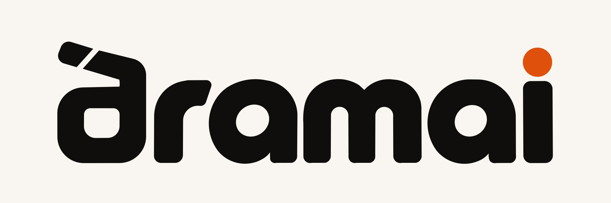
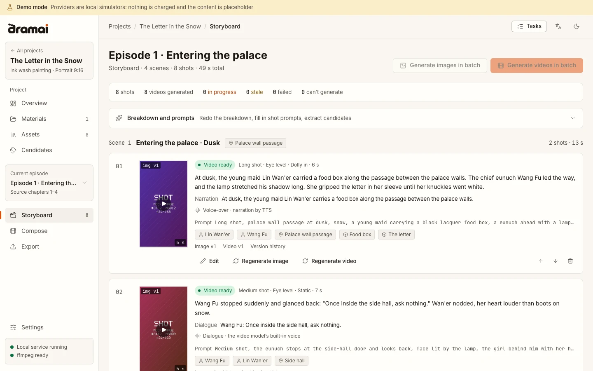
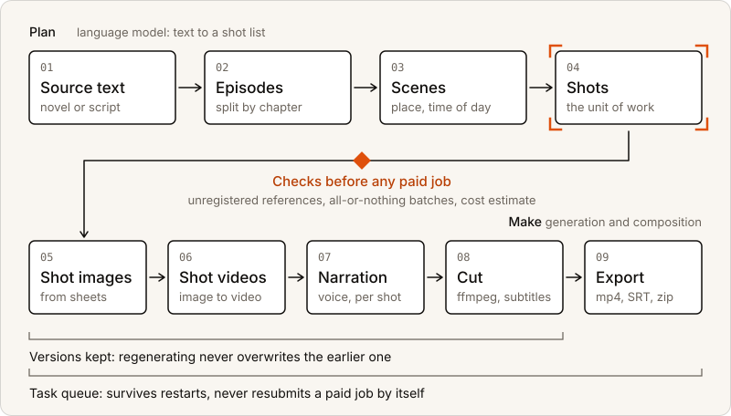
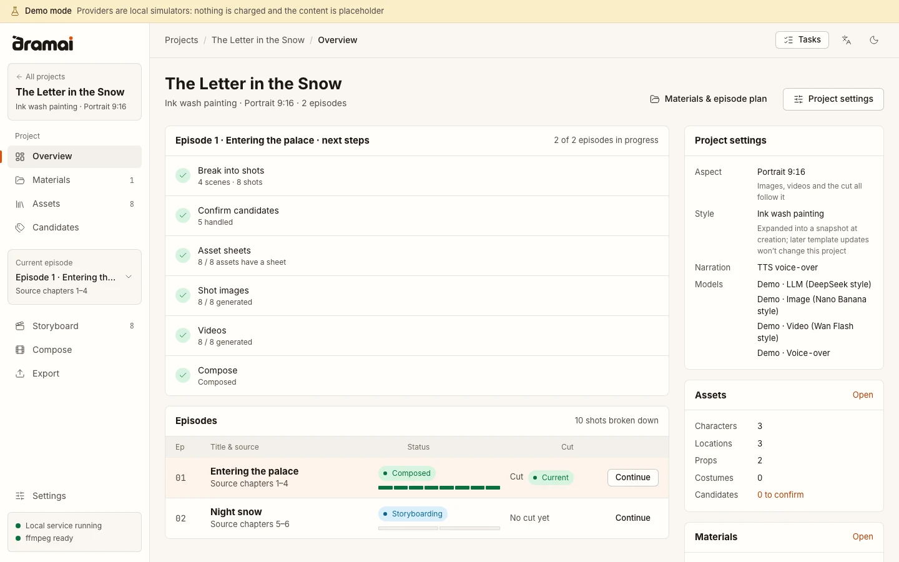
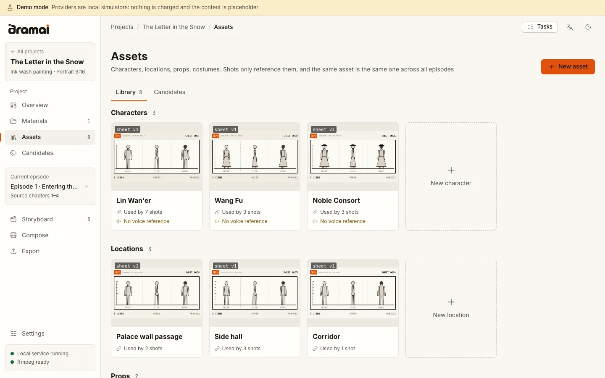
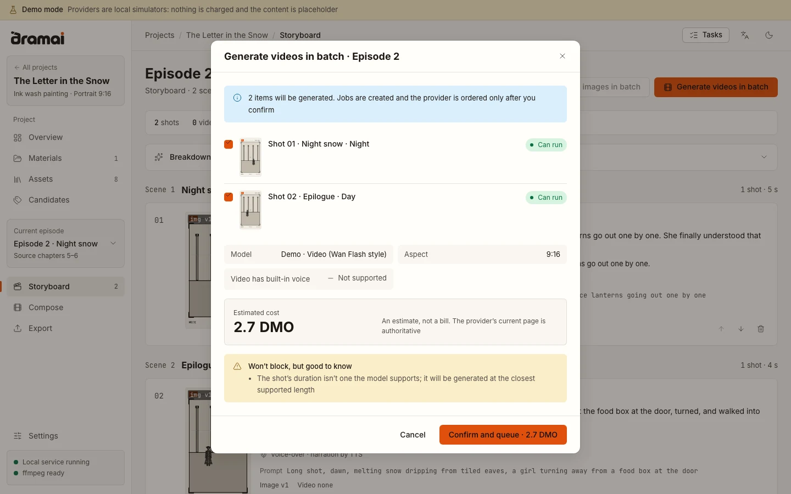
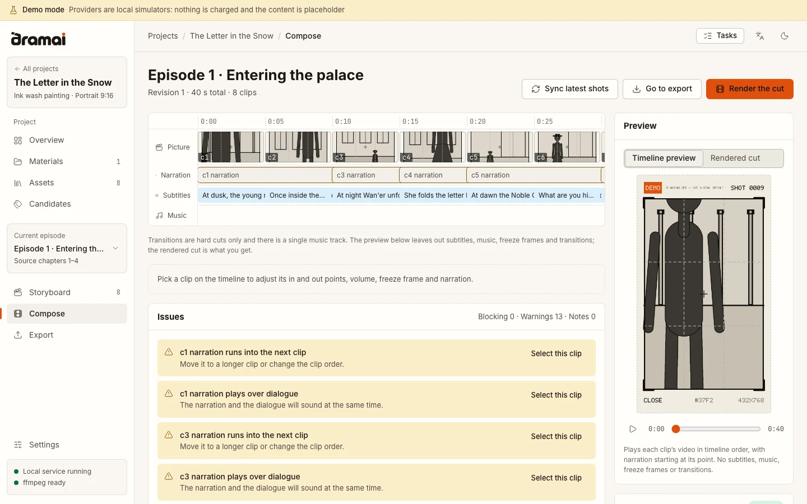
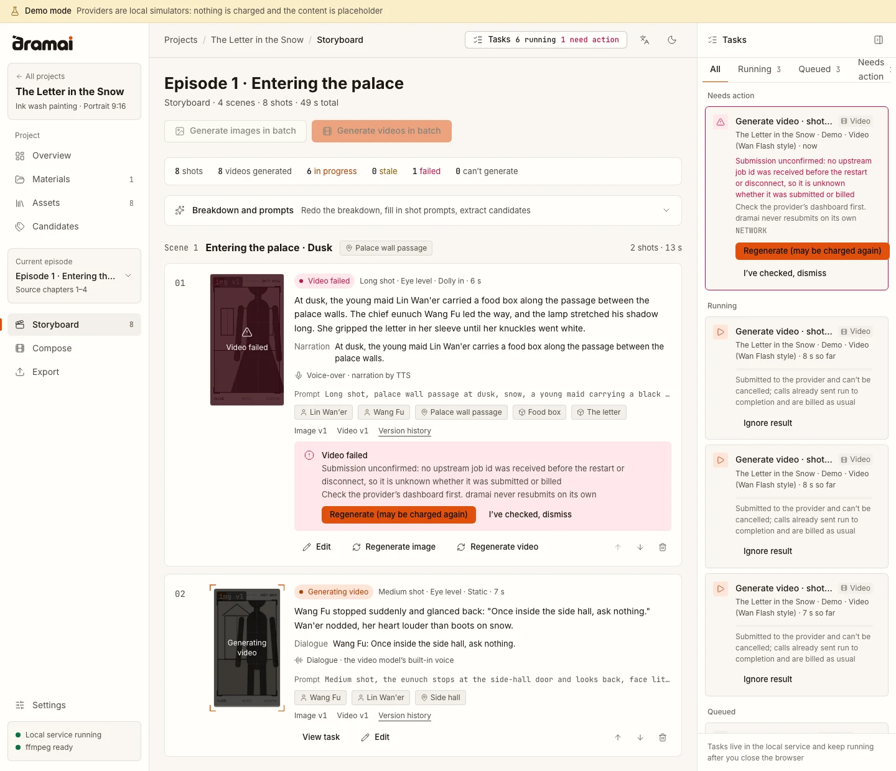

<div align="center">

<picture>
  <source media="(prefers-color-scheme: dark)" srcset="./packages/ui/src/brand/banner-ink.svg" />
  
</picture>

**English** · [简体中文](./README_CN.md) · [Introduction page](https://hyyyyyyz.github.io/dramai/en/)

[](./LICENSE) [](https://github.com/hyyyyyyz/dramai/actions/workflows/ci.yml) [](https://github.com/hyyyyyyz/dramai/releases) [](https://github.com/hyyyyyyz/dramai) [](https://github.com/hyyyyyyz/dramai/forks)

</div>

dramai is an open-source AI short-drama studio that runs on your own computer. Give it a novel or a script and it plans episodes, scenes and shots, generates images and video through the AI providers you choose, and composes a finished cut with narration and subtitles.

It is for people who make serialised short dramas and want to keep control of the work. Projects are ordinary folders on your disk, API keys stay on your machine, and nothing passes through a service we run.

> [!NOTE]
> **Beta.** The latest published version is `0.5.0-beta.1`, and the repository contains newer work (see [News](#news)). The desktop installers on [Releases](https://github.com/hyyyyyyz/dramai/releases) are the `0.5.0-beta.1` pre-release; the newer features run from source. See [Status](#status).

<p align="center">
  <picture>
    <source media="(prefers-color-scheme: dark)" srcset="./docs/assets/readme/en/storyboard-dark.webp" />
    
  </picture>
  <br />
  <sub>The storyboard of a small demo project. The pictures are placeholder sketches made by demo mode, not generated art.</sub>
</p>

## Quick Start

There are three ways in. The first two start from a checkout of the source and include everything described on this page; the third is a published installer, which does not (see [Desktop installer](#3-desktop-installer)).

You need [Node.js](https://nodejs.org) 22.22.2 or newer and [pnpm](https://pnpm.io) 9. [ffmpeg](https://ffmpeg.org) on your `PATH` renders the cut and makes the placeholder videos of demo mode. It is not bundled with dramai, so install it with `brew install ffmpeg` (macOS), `winget install Gyan.FFmpeg` (Windows) or your package manager (`apt install ffmpeg`). Without it the app still starts and everything except rendering works; the error says that ffmpeg is missing. Burning subtitles into the picture needs a build with libass, and soft subtitles work with any build. Settings → About shows what your ffmpeg can do.

Paths 1 and 2 share the same setup:

```bash
git clone https://github.com/hyyyyyyz/dramai.git
cd dramai
pnpm install
pnpm build
```

On a machine with a warm package cache this took under 20 seconds (install 3 s, build 14 s). The first install downloads the dependencies, so allow longer.

### 1. Demo mode, no API key

```bash
pnpm demo
```

Open <http://127.0.0.1:8787>. Demo mode runs the whole studio on your machine with built-in simulated providers: no account, no key, and no request leaves your computer. It generates placeholder content, storyboard-style sketches of a figure in a frame marked DEMO and short clips built from them, so you can follow the workflow from text to cut; with real providers the pictures and videos come from the models you choose. Create a project, upload a short story, plan episodes, break them into shots, confirm the characters and locations, then generate images and video and compose the cut. The demo's language model reads Chinese text, so use a Chinese story. Demo data lives in `~/.dramai-demo`, separate from your real data; add `--fresh` to start over, or `--lang en` for English terminal messages. Stop it with Ctrl+C.

### 2. WebUI, with your own providers

```bash
pnpm webui
```

This starts the local server, serves the workspace at <http://127.0.0.1:8787> and opens your browser. Add a provider in Settings → Providers, run "test connection", and make a project. Data lives in `~/.dramai`. Stop it with Ctrl+C. Options such as `--port`, `--data-dir` and `--no-open` are described under "More ways to run it" below.

Providers are presets grouped by vendor, each labelled with what has been verified; see [Providers](#providers).

### 3. Desktop installer

Download from [GitHub Releases](https://github.com/hyyyyyyz/dramai/releases). Only `0.5.0-beta.1` is published, and it is marked as a pre-release. Choose by system:

- **macOS**: the `.dmg`, `mac-arm64` for Apple silicon or `mac-x64` for Intel.
- **Windows**: the `.exe` installer or the portable `.zip`.
- **Linux**: the `.AppImage` or the `.tar.gz`.

`SHA256SUMS.txt` lists the checksums. The installers are unsigned, so macOS and Windows warn the first time you open one, and they do not include ffmpeg or update themselves. The macOS Apple silicon installer has been tried on a real machine; CI builds the desktop app on macOS (Apple silicon), Windows and Linux and runs a sandboxed install, start-up check and uninstall on each, and the release workflow builds the installers for every system, macOS Intel included. How to open an unsigned app on each system is in [apps/desktop](./apps/desktop/README.md).

**The installer corresponds to `0.5.0-beta.1`.** The features added since, the additional text, image, video and speech providers, sign-in with OpenAI and OpenRouter, the preset catalog grouped by vendor, reference images for video and the narration voice options, currently run from source: take path 1 or 2, or build the desktop app from source (below). See [News](#news).

<details>
<summary><strong>More ways to run it</strong>: WebUI options, desktop from source, where data lives</summary>

<br />

```bash
pnpm webui --port 9000 --data-dir ~/dramai-data --no-open
```

The default address is `http://127.0.0.1:8787` and the default data directory is `~/.dramai`. The server only listens on `127.0.0.1`; to reach it from another device you must pass `--host` together with an access token. In the WebUI, API keys are kept in `secrets.json` in the data directory, not encrypted; on macOS and Linux the file permissions limit it to you. See [apps/webui](./apps/webui/README.md).

The desktop app can also be run or built from the same checkout, with ffmpeg installed:

- `pnpm desktop:dev`: an Electron window around the same server and workspace, run from source.
- `pnpm desktop:install`: builds the app on your machine and installs it for the current user. No certificate and no download warnings, because the app is made on your machine. `pnpm desktop:uninstall` removes it and keeps your data.

The desktop app keeps your data in your user folder (for example `~/Library/Application Support/Dramai/data` on macOS) and stores API keys with the operating system's key store where one exists. macOS asks for Keychain access again after each upgrade of an unsigned build. The steps are in [apps/desktop](./apps/desktop/README.md), along with the build, install and uninstall details.

</details>

## News

Newest first. **Source** entries are in the repository and run from source; **Release** entries are in the published `0.5.0-beta.1` installer. The full list is in the [changelog](./CHANGELOG.md).

- **2026-11-14 · The introduction page.** <https://hyyyyyyz.github.io/dramai/> is the project's introduction page, in Chinese at the root and in English at [`/en/`](https://hyyyyyyz.github.io/dramai/en/). It replaces the v0.4 web app that was hosted at that address. The source is in `apps/site`; see [docs/DEPLOYMENT.md](./docs/DEPLOYMENT.md).
- **2026-11-13 · Source · Speech providers and narration voices.** Narration can use OpenAI, SiliconFlow, MiniMax or Alibaba CosyVoice, with six presets set up from the vendors' official documentation. A project's narration voice can carry a style instruction and a language hint where the provider takes them, and the check before generating covers the voice and the text length. See the [changelog](./CHANGELOG.md#unreleased).
- **2026-11-13 · Source · Video providers and reference images.** Seedance (Volcengine and BytePlus), Kling 4.0 and Tongyi Wanxiang 3.0, with six presets set up from the official documentation. A task option, off by default, sends a shot's character, scene and prop sheets to the video model as reference images; where the documentation makes that exclusive with a first frame, the confirmation dialog says what is given up before anything is ordered. See the [changelog](./CHANGELOG.md#unreleased).
- **2026-11-13 · Source · More text and image providers, account sign-in, a preset catalog by vendor.** New presets for language models and images, set up from the official documentation and grouped by vendor in Settings → Providers, each labelled with its status. Sign in with a ChatGPT account (text only) or an OpenRouter account instead of pasting a key. See [Providers](#providers) and the [changelog](./CHANGELOG.md#unreleased).
- **2026-11-12 · Release · [`v0.5.0-beta.1`](https://github.com/hyyyyyyz/dramai/releases/tag/v0.5.0-beta.1) published as a pre-release.** The rewrite as a local server with a workspace, a desktop app and unsigned installers for macOS, Windows and Linux. See the [changelog](./CHANGELOG.md#050-beta1---2026-11-12).

## What is different

- **Local, with your keys.** A server on `127.0.0.1` does all the work. Projects are folders of ordinary files plus a SQLite database. Provider requests are made by that server, so there is no CORS limit and no relay in between.
- **Long texts and serials.** A project holds episodes, episodes hold scenes, scenes hold shots. Long texts are split into episodes by chapter.
- **A reusable library.** Characters, locations, props and costumes are assets that shots refer to. Each asset has one reference sheet that every shot using it is generated from. The visual style is chosen once, when the project is created.
- **Many providers, each labelled with its source.** Language model, image, video and speech providers are presets from sixteen vendors; four have been run end to end and the rest are set up from the vendors' official documentation, and Settings shows which is which. A preset set up from the documentation is never selected for you.
- **Checks before paid generation.** Shots that refer to an unregistered asset, or one without a reference image, are blocked. A batch runs completely or not at all, a shot has at most one video task in flight, and for models with a price entry a cost estimate is shown before you confirm.
- **A task queue that survives restarts.** Closing the browser does not stop work. After a restart, a video task that has an upstream task id resumes polling. One without it is marked "submission unconfirmed" and is never resubmitted automatically. Cancelling only affects tasks that are still queued.
- **Versions kept.** Regenerating adds a version and does not overwrite the previous one. When something upstream changes, what depends on it is marked out of date, and nothing is regenerated on its own.
- **Native ffmpeg composition.** The cut is rendered with the ffmpeg installed on your machine, in 9:16, 16:9 or 1:1, with narration voice, soft or burned-in subtitles, SRT and VTT, and an asset package for editing elsewhere.

The workspace speaks English, Simplified Chinese and Traditional Chinese, in a light and a dark theme.

## Providers

Providers are presets in Settings → Providers, grouped by vendor. Each preset is labelled with how it was verified:

- **Run end to end** (4): DeepSeek for language models, Seedream and Nano Banana for images and Wan 2.2 Flash for video, the last three through 302.AI. They were run in v0.4 in May 2026, before the rewrite.
- **Set up from the official documentation** (36): the address, protocol and model ids follow each vendor's published documentation. Settings → Providers marks each of them as set up from the official docs, and you choose one yourself: they never become the current choice on their own.

That makes 40 presets from 16 vendors. By kind (run end to end + from the documentation):

- **Language models** (1 + 16): DeepSeek (run end to end); OpenAI, Anthropic, Google Gemini, Alibaba Cloud Model Studio (China and international sites), Volcengine Ark, Zhipu, Moonshot Kimi, MiniMax, SiliconFlow, OpenRouter and 302.AI; Ollama and LM Studio for models on your own machine.
- **Images** (2 + 8): Seedream and Nano Banana through 302.AI (run end to end); OpenAI, Volcengine, MiniMax, Google Gemini, Alibaba Cloud Model Studio Qwen-Image (two sites), SiliconFlow and Kling.
- **Video** (1 + 6): Wan 2.2 Flash through 302.AI (run end to end); Volcengine and BytePlus Seedance, Kling 4.0 (two sites) and Alibaba Cloud Model Studio Wan 3.0 (two sites).
- **Speech** (0 + 6): OpenAI, SiliconFlow (two sites), MiniMax (two sites) and Alibaba Cloud Model Studio CosyVoice (China site).

Two presets sign in with an account instead of a key. **OpenAI**: you sign in with a ChatGPT account and text requests use your ChatGPT plan; it covers language models only, so images, video and speech still need API keys. **OpenRouter**: you sign in and OpenRouter hands dramai an API key of your own, which is then used like a key you pasted; usage is billed to your OpenRouter account. Sign-in must be done on the computer that runs dramai, because the authorisation comes back to a local address.

## How a project moves

<p align="center">
  <picture>
    <source media="(prefers-color-scheme: dark)" srcset="./docs/assets/readme/pipeline-en-dark.svg" />
    
  </picture>
</p>

In words: source text → episodes → scenes → shots → shot images → shot videos → narration → composed cut with subtitles → export.

<details>
<summary><strong>More screens</strong>: project overview, asset library, checks before generating, compose timeline, task panel</summary>

<br />

<picture>
  <source media="(prefers-color-scheme: dark)" srcset="./docs/assets/readme/en/overview-dark.webp" />
  
</picture>

**Project overview.** The next steps for the current episode, and the state of every episode.

<picture>
  <source media="(prefers-color-scheme: dark)" srcset="./docs/assets/readme/en/assets-dark.webp" />
  
</picture>

**Asset library.** Characters, locations, props and costumes. The three-view sheets shown here are placeholder sketches from demo mode.

<picture>
  <source media="(prefers-color-scheme: dark)" srcset="./docs/assets/readme/en/confirm-dark.webp" />
  
</picture>

**Checks before generating.** Nothing is ordered from a provider until you confirm. The amount is in the demo's fictional currency. The option at the top sends character, scene and prop sheets to the video model as references; it is off by default and cannot be turned on here because the demo's video model does not take references.

<picture>
  <source media="(prefers-color-scheme: dark)" srcset="./docs/assets/readme/en/compose-dark.webp" />
  
</picture>

**Compose.** A timeline of picture, narration, subtitles and music, with a list of issues that would block rendering.

<picture>
  <source media="(prefers-color-scheme: dark)" srcset="./docs/assets/readme/en/tasks-dark.webp" />
  
</picture>

**Task panel.** Tasks that need action, running tasks and the queue, with the storyboard updating beside it. The task at the top was cut off before the provider confirmed it: dramai says so, asks you to check the provider's dashboard, and never resubmits it on its own. Tasks already submitted to a provider cannot be cancelled and are billed as usual.

</details>

## Status

**What you can do today**

- Run the whole workflow end to end: upload a text, plan episodes, break down shots, confirm characters and locations, generate images and video, compose, export. Demo mode does it with no key; the WebUI and the desktop app do it with the providers you connect (see [Providers](#providers)).
- Choose from 40 provider presets from 16 vendors, covering language models, images, video and speech, and sign in with a ChatGPT or OpenRouter account. Four presets were run end to end; the rest are set up from the vendors' official documentation, and Settings → Providers labels each one. See [Providers](#providers).
- Render the cut with your own ffmpeg in 9:16, 16:9 or 1:1, with narration, soft or burned-in subtitles, SRT and VTT, and music. Transitions are hard cuts and there is one music track; the timeline preview plays picture and narration, and the rendered cut adds subtitles and music.
- Install the desktop app as a `0.5.0-beta.1` pre-release on macOS, Windows and Linux, build and install it from source, or run the WebUI. The macOS Apple silicon installer has been tried on a real machine (the window loads, the server is healthy and authentication works); CI builds the desktop app on macOS (Apple silicon), Windows and Linux and runs a sandboxed install, start-up check and uninstall on each.
- Rely on browser tests (Playwright) for that path, resuming a failed task, the English interface and keyboard-only use, and on automated tests for the provider protocols, the sign-in flows and the checks before generating.

**Coming next**

- An npm package and a Docker image.

Settings → Providers lists the presets by vendor and can test a connection. The full list of changes is in the [changelog](./CHANGELOG.md).

## Coming from v0.4

v0.4 was a browser-only app and kept its data in the browser, so version 0.5 does not see it automatically. If you exported a JSON backup from v0.4, import it in Settings → Data & backup; [CHANGELOG.md](./CHANGELOG.md) has the upgrade steps. To keep using v0.4, check out the [`v0.4.1`](https://github.com/hyyyyyyz/dramai/releases/tag/v0.4.1) tag and run it locally; a locally run copy has its own browser storage, so it starts empty. The v0.4 web app is no longer hosted at `hyyyyyyz.github.io/dramai`, which is now the introduction page.

## Documentation

- [Introduction page](https://hyyyyyyz.github.io/dramai/en/): What dramai is, in Chinese and English
- [CHANGELOG.md](./CHANGELOG.md): What each release contains, what changed since `0.5.0-beta.1`, incompatible changes and upgrade notes
- [apps/webui](./apps/webui/README.md) · [apps/desktop](./apps/desktop/README.md): Starting the server, and the three desktop forms
- [packages/mock-providers](./packages/mock-providers/README.md): Demo mode and its built-in providers
- [packages/server](./packages/server/README.md) · [packages/api](./packages/api/README.md) · [packages/core](./packages/core/README.md) · [packages/workspace](./packages/workspace/README.md): The local server (including provider presets and sign-in), its typed API, the engine and the workspace
- [docs/DEPLOYMENT.md](./docs/DEPLOYMENT.md): What is deployed (the introduction page) and why the app is not hosted
- [docs/VERSIONING.md](./docs/VERSIONING.md) · [docs/RELEASING.md](./docs/RELEASING.md) · [docs/CI.md](./docs/CI.md): Version numbers, releasing, continuous integration

`docs/ARCHITECTURE.md`, `docs/PROVIDERS.md` and `docs/ROADMAP.md` are the original v0.4 design notes, in Chinese; the current behaviour is described in the package notes above and in the changelog. The package notes mix Chinese and English.

## Contributing

Issues and pull requests are welcome; see [CONTRIBUTING.md](./CONTRIBUTING.md). Commits follow Conventional Commits, and `pnpm typecheck`, `pnpm lint`, `pnpm test` and `pnpm format:check` should pass before you open a pull request.

## Versioning

One version number covers every package. While the major version is 0, new features and incompatible changes raise the minor number and fixes raise the patch number; incompatible changes are always called out in the changelog. Pre-release versions such as `0.5.0-beta.1` are marked as pre-releases on GitHub. The rules are in [docs/VERSIONING.md](./docs/VERSIONING.md).

## License

[Apache License 2.0](./LICENSE) © 2026 hyyyyyyz and dramai contributors.

## Acknowledgements

dramai draws on two open-source projects for ideas: [xhongc/ai_story](https://github.com/xhongc/ai_story) for the pipeline and the design of the AI client layer, and [freestylefly/director_ai](https://github.com/freestylefly/director_ai) for the character-consistency approach and the documented video workflow. dramai is an independent TypeScript implementation and contains no source code from either.
