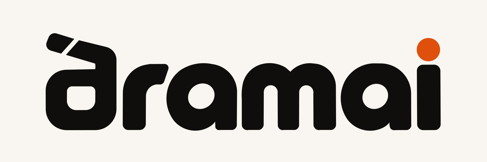
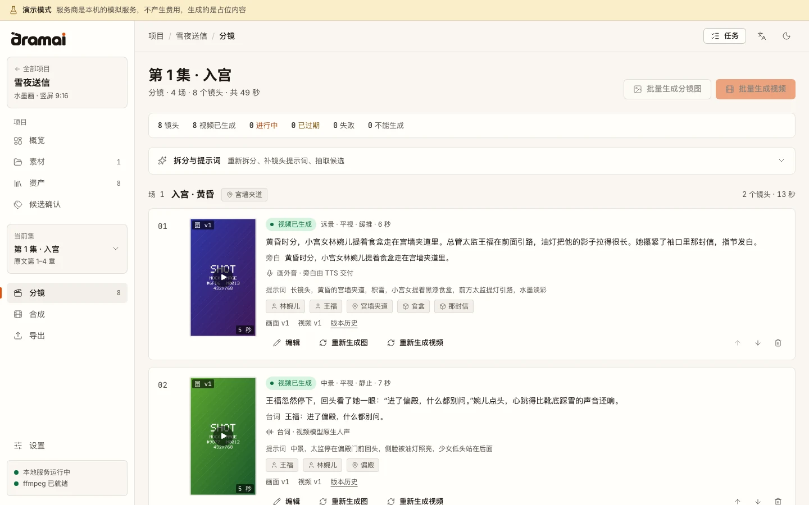
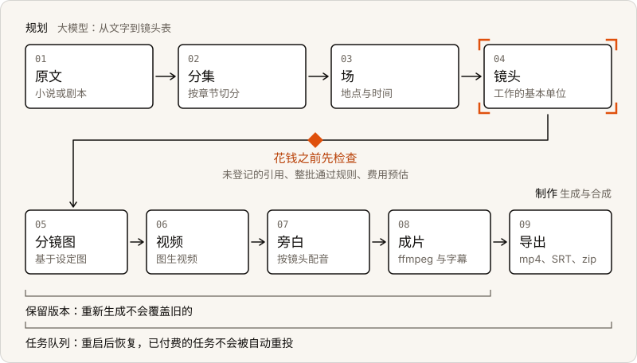
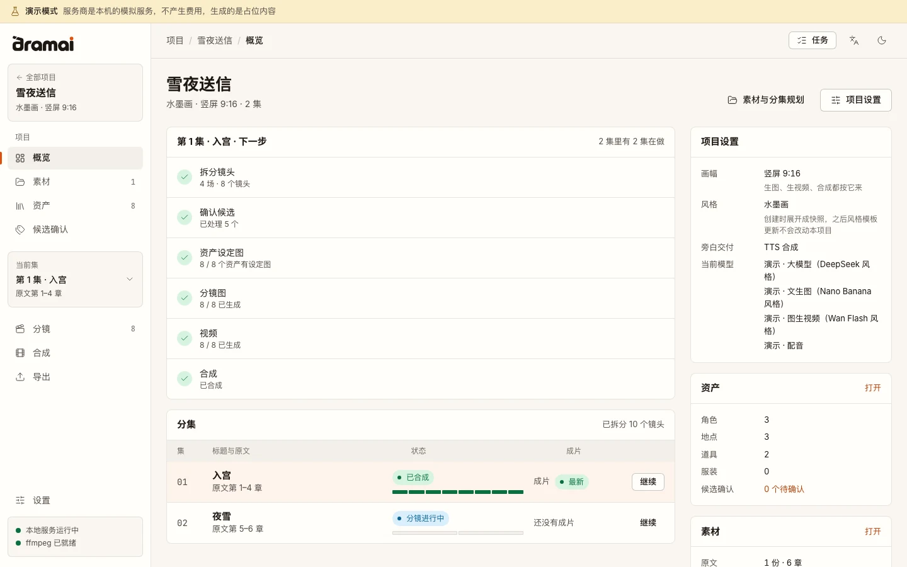
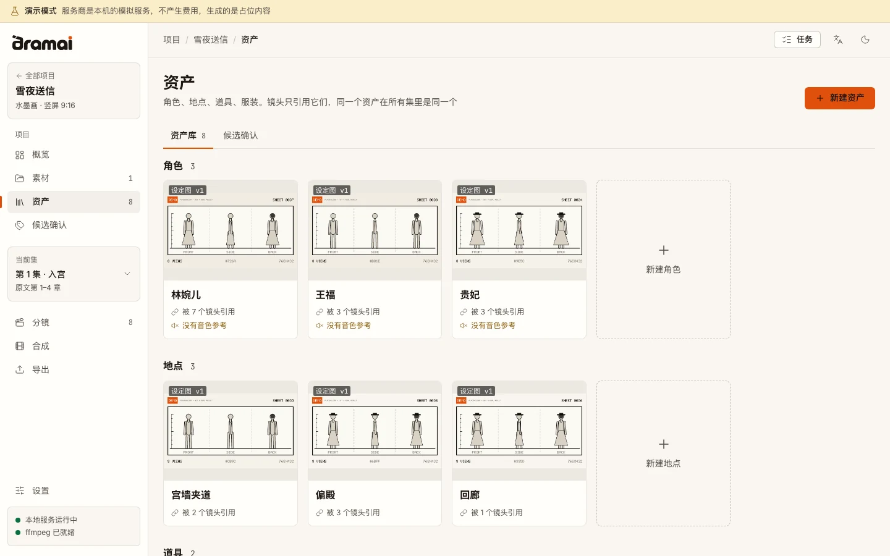
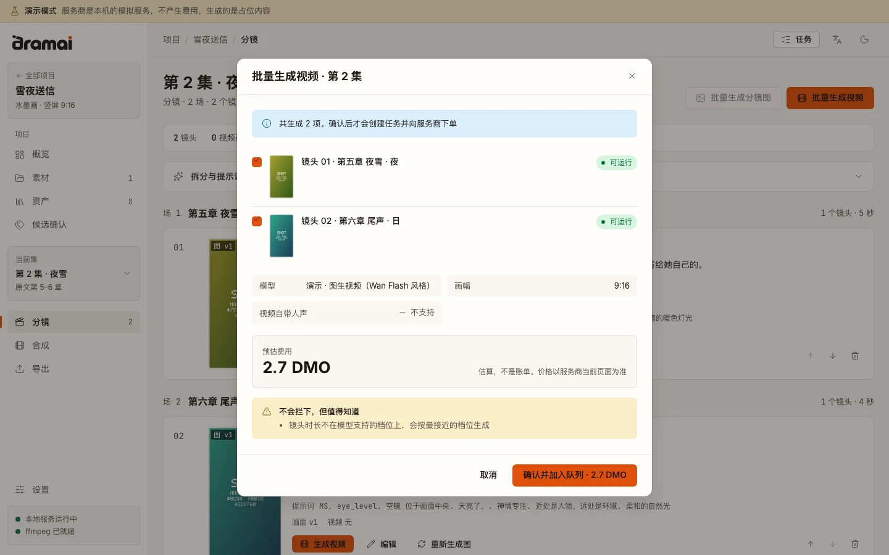
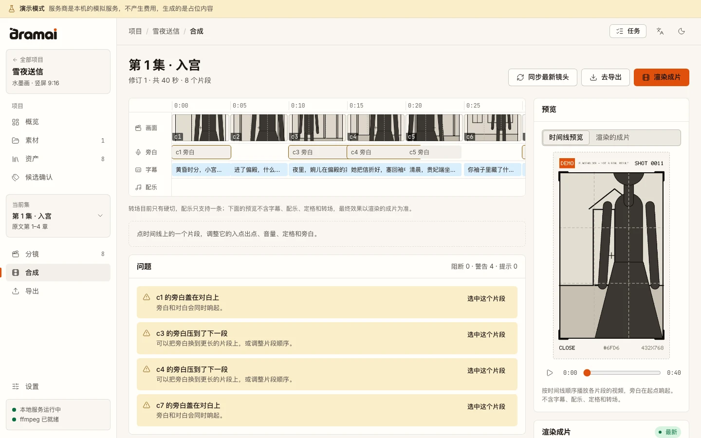
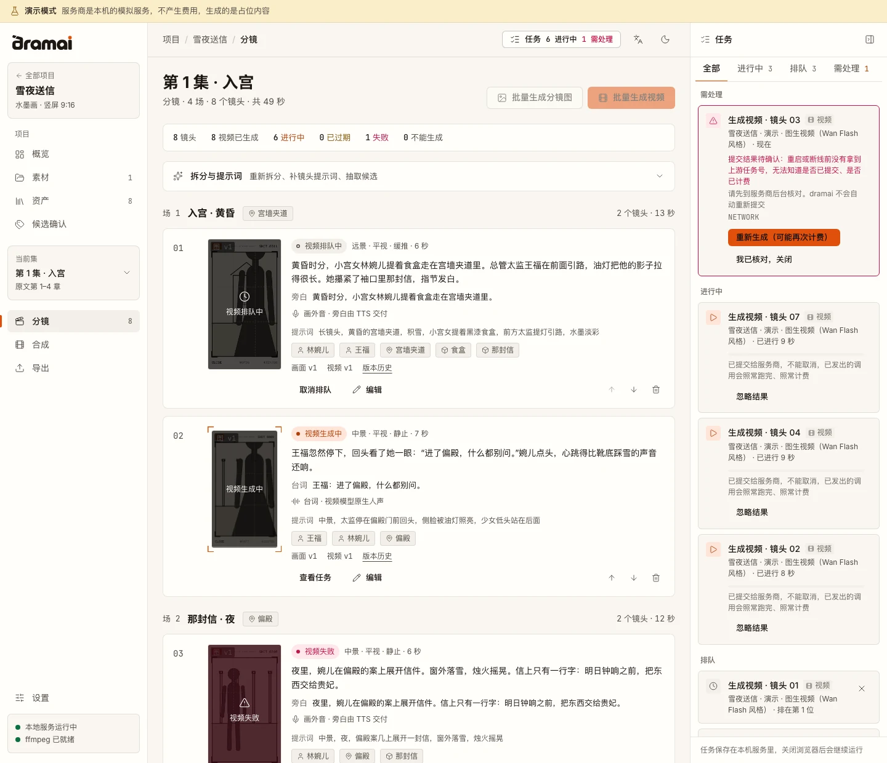

<div align="center">

<picture>
  <source media="(prefers-color-scheme: dark)" srcset="./packages/ui/src/brand/banner-ink.svg" />
  
</picture>

[English](./README.md) · **简体中文** · [介绍页](https://hyyyyyyz.github.io/dramai/)

[](./LICENSE) [](https://github.com/hyyyyyyz/dramai/actions/workflows/ci.yml) [](https://github.com/hyyyyyyz/dramai/releases) [](https://github.com/hyyyyyyz/dramai) [](https://github.com/hyyyyyyz/dramai/forks)

</div>

dramai 是一个开源的 AI 短剧工作室，在你自己的电脑上运行。给它一部小说或一份剧本，它会规划出集、场和镜头，通过你选择的 AI 服务商生成图片和视频，再合成带旁白和字幕的成片。

它面向做连载短剧、又想把作品握在自己手里的人：项目是你磁盘上的普通文件夹，API Key 留在你的电脑上，不经过任何由我们运营的服务。

> [!NOTE]
> **测试版。** 已发布的最新版本是 `0.5.0-beta.1`，仓库里还有更新的内容（见[动态](#动态)）。[Releases](https://github.com/hyyyyyyz/dramai/releases) 上的桌面端安装包是 `0.5.0-beta.1` 预发布；更新的功能从源码运行。详见[现状](#现状)。

<p align="center">
  <picture>
    <source media="(prefers-color-scheme: dark)" srcset="./docs/assets/readme/zh/storyboard-dark.webp" />
    
  </picture>
  <br />
  <sub>一个小型演示项目的分镜页。画面是演示模式生成的占位草图，不是生成出来的作品。</sub>
</p>

## 快速开始

有三种方式。前两种从源码检出开始，包含本页描述的全部内容；第三种是已发布的安装包，它不包含（见[桌面端安装包](#3-桌面端安装包)）。

你需要 [Node.js](https://nodejs.org) 22.22.2 或更新版本和 [pnpm](https://pnpm.io) 9。在 `PATH` 里能找到的 [ffmpeg](https://ffmpeg.org) 负责渲染成片，演示模式的占位视频也用它来做。dramai 不附带 ffmpeg，请自己安装：macOS 用 `brew install ffmpeg`，Windows 用 `winget install Gyan.FFmpeg`，Linux 用包管理器（如 `apt install ffmpeg`）。没有它时应用照常启动，除渲染成片外的功能都能用，报错会说明缺少 ffmpeg。把字幕烧录进画面需要带 libass 的 ffmpeg，软字幕用任何版本都行。设置 → 关于 里能看到你的 ffmpeg 支持什么。

第 1、2 种方式的准备步骤相同：

```bash
git clone https://github.com/hyyyyyyz/dramai.git
cd dramai
pnpm install
pnpm build
```

在包缓存已热的机器上，这一步用了不到 20 秒（安装 3 秒，构建 14 秒）。第一次安装要下载依赖，会更久。

### 1. 演示模式，不需要 API Key

```bash
pnpm demo
```

打开 <http://127.0.0.1:8787>。演示模式在你的电脑上用内置的模拟服务商跑完整个工作室：不用注册账号，不用 Key，不会有任何请求离开你的电脑。它生成的是占位内容：画框里一个人形的分镜草图，标着 DEMO，再用它们做成的短片段，让你从文本到成片把流程走一遍；接上真实的服务商之后，图片和视频来自你选的模型。新建一个项目，上传一个短篇故事，规划分集，拆分镜头，确认角色和地点，然后生成图片和视频，最后合成成片。演示用的大模型读中文文本，所以请用中文故事。演示用的数据放在 `~/.dramai-demo`，和你的正式数据分开；加上 `--fresh` 可以清空重来，加上 `--lang en` 让终端提示用英文。按 Ctrl+C 停止。

### 2. WebUI，用你自己的服务商

```bash
pnpm webui
```

这会启动本地服务，在 <http://127.0.0.1:8787> 托管工作台，并打开浏览器。在 设置 → 服务商 里添加服务商，点“测试连接”，然后建项目。数据放在 `~/.dramai`。按 Ctrl+C 停止。`--port`、`--data-dir`、`--no-open` 等选项见下面的“更多运行方式”。

服务商是按厂商分组的预设，每个都标明验证到了什么程度，见[服务商](#服务商)。

### 3. 桌面端安装包

到 [GitHub Releases](https://github.com/hyyyyyyz/dramai/releases) 下载。目前只发布了 `0.5.0-beta.1`，它标为预发布。按系统选：

- **macOS**：`.dmg`，Apple 芯片用 `mac-arm64`，Intel 用 `mac-x64`。
- **Windows**：`.exe` 安装程序或免安装的 `.zip`。
- **Linux**：`.AppImage` 或 `.tar.gz`。

`SHA256SUMS.txt` 里是校验和。安装包不签名，所以 macOS 和 Windows 第一次打开时会给出警告；它们也不带 ffmpeg，不会自动更新。macOS Apple 芯片的安装包在真机上试过；CI 在 macOS（Apple 芯片）、Windows 和 Linux 上构建桌面端应用，并在各自的系统上跑一次沙箱里的安装、启动检查和卸载；发布工作流构建各系统的安装包，包括 macOS Intel。未签名的应用在各系统上怎么打开，见 [apps/desktop](./apps/desktop/README.md)。

**安装包对应 `0.5.0-beta.1`。** 那之后新增的文本、图片、视频和配音服务商，OpenAI 和 OpenRouter 账号登录，按厂商分组的预设目录，视频的参考图，以及旁白音色选项，目前从源码运行：走第 1 或第 2 种方式，或者从源码构建桌面端（见下）。参见[动态](#动态)。

<details>
<summary><strong>更多运行方式</strong>：WebUI 选项、从源码运行桌面端、数据位置</summary>

<br />

```bash
pnpm webui --port 9000 --data-dir ~/dramai-data --no-open
```

默认地址是 `http://127.0.0.1:8787`，默认数据目录是 `~/.dramai`。服务只监听 `127.0.0.1`；想从别的设备访问，必须同时给 `--host` 和访问令牌。WebUI 下，API Key 保存在数据目录的 `secrets.json` 里，没有加密；macOS 和 Linux 上文件权限设为仅本人可读。详见 [apps/webui](./apps/webui/README.md)。

桌面端也可以用同一份检出运行或编译，需要先装好 ffmpeg：

- `pnpm desktop:dev`：从源码运行，一个 Electron 窗口，里面是同一个服务和同一个工作台。
- `pnpm desktop:install`：在你的机器上编译并安装给当前用户。不需要证书，也没有下载警告，因为应用是在你自己的电脑上生成的。`pnpm desktop:uninstall` 卸载应用，保留你的数据。

桌面端把数据放在你的用户目录下（例如 macOS 上是 `~/Library/Application Support/Dramai/data`），有系统密钥库时用它保存 API Key。未签名的版本在 macOS 上每次升级后会再次询问钥匙串访问。放行的步骤以及编译、安装、卸载的细节见 [apps/desktop](./apps/desktop/README.md)。

</details>

## 动态

按时间倒序。标为**源码**的在仓库里，从源码运行；标为**发布**的在已发布的 `0.5.0-beta.1` 安装包里。完整清单见[更新日志](./CHANGELOG.md)。

- **2026-11-14 · 介绍页。** <https://hyyyyyyz.github.io/dramai/> 是项目的介绍页，中文在根路径，英文在 [`/en/`](https://hyyyyyyz.github.io/dramai/en/)。它取代了此前托管在这个地址上的 v0.4 网页应用。源码在 `apps/site`，见 [docs/DEPLOYMENT.md](./docs/DEPLOYMENT.md)。
- **2026-11-13 · 源码 · 配音服务商和旁白音色。** 旁白可以用 OpenAI、硅基流动、MiniMax 或阿里 CosyVoice，共六个预设，按各厂商的官方文档接入。项目的旁白音色在服务商支持时可以带风格指令和语言提示；生成前的检查会核对音色和文本长度。见[更新日志](./CHANGELOG.md#unreleased)。
- **2026-11-13 · 源码 · 视频服务商和参考图。** 火山方舟与 BytePlus 的 Seedance、可灵 4.0、通义万相 3.0，共六个预设，按官方文档接入。一个默认关闭的任务选项，会把镜头引用的角色、场景和道具设定图作为参考图交给视频模型；文档里参考图与首帧互斥的模型，确认对话框会在下单之前说明放弃了什么。见[更新日志](./CHANGELOG.md#unreleased)。
- **2026-11-13 · 源码 · 更多文本和图片服务商、账号登录、按厂商分组的预设目录。** 新增大模型和图片的预设，按官方文档接入，在 设置 → 服务商 里按厂商分组，每个都标明状态。可以用 ChatGPT 账号（只覆盖文本）或 OpenRouter 账号登录，不必再粘贴 Key。见[服务商](#服务商)和[更新日志](./CHANGELOG.md#unreleased)。
- **2026-11-12 · 发布 · [`v0.5.0-beta.1`](https://github.com/hyyyyyyz/dramai/releases/tag/v0.5.0-beta.1) 作为预发布公开。** 重写后的版本：本地服务加工作台、桌面端，以及 macOS、Windows 和 Linux 的未签名安装包。见[更新日志](./CHANGELOG.md#050-beta1---2026-11-12)。

## 有什么不同

- **本地运行，Key 在你手里。** 一个监听 `127.0.0.1` 的服务完成所有工作。项目是普通文件加一个 SQLite 数据库。请求由这个服务直接发给服务商，没有 CORS 限制，中间也没有转发。
- **长文本和连载。** 一个项目包含集，集包含场，场包含镜头。长文本按章节切分成集。
- **可复用的资产库。** 角色、地点、道具和服装是资产，镜头通过引用使用它们。每个资产有一张设定图，所有用到它的镜头都以它为参考生成。画风在建项目时选定一次。
- **服务商多，每个都标明来源。** 大模型、图片、视频和配音服务商是来自十六个厂商的预设；四个端到端跑过，其余按厂商的官方文档接入，设置里标明哪个是哪个。按文档接入的预设不会被自动选上。
- **花钱之前先检查。** 引用了未登记资产、或没有参考图的资产的镜头会被拦下；一批任务要么整批执行，要么都不执行；一个镜头同一时间最多只有一个视频任务；有价目的模型在确认之前会给出费用预估。
- **重启后不丢的任务队列。** 关掉浏览器不会中断工作。重启之后，有上游任务号的视频任务会继续轮询；没有的会标成“提交结果待确认”，**不会被自动重新提交**。取消只作用于还在排队的任务。
- **保留版本。** 重新生成会新增一个版本，不覆盖旧的。上游内容变了，依赖它的产物会标为过期，但不会自动重新生成。
- **原生 ffmpeg 合成。** 成片由你电脑上的 ffmpeg 渲染，支持 9:16、16:9、1:1，带旁白配音、软字幕或烧录字幕、SRT 和 VTT，还能导出素材包到别的软件里继续剪。

工作台提供英文、简体中文和繁体中文界面，有浅色和深色两套主题。

## 服务商

服务商是 设置 → 服务商 里按厂商分组的预设，每个都标明状态：

- **端到端跑过**（4 个）：大模型里的 DeepSeek，图片里的 Seedream 和 Nano Banana，以及视频里的 Wan 2.2 Flash，后三个走的是 302.AI。它们是 2026 年 5 月在 v0.4 里跑的，那是重写之前。
- **按官方文档接入**（36 个）：接口地址、协议和模型名都依照各厂商公布的文档。设置 → 服务商 里标明它们是按官方文档接入的，要你自己选用：它们不会自动成为当前选择。

合计 40 个预设，来自 16 个厂商。按类别分（端到端跑过 + 按官方文档接入）：

- **大模型**（1 + 16）：DeepSeek（端到端跑过）；OpenAI、Anthropic、Google Gemini、阿里云百炼（国内站和国际站）、火山方舟、智谱 AI、Moonshot AI（Kimi）、MiniMax、硅基流动、OpenRouter 和 302.AI；还有在你自己机器上跑模型的 Ollama 和 LM Studio。
- **图片**（2 + 8）：302.AI 上的 Seedream 和 Nano Banana（端到端跑过）；OpenAI、火山方舟、MiniMax、Google Gemini、阿里云百炼的 Qwen-Image（两个站点）、硅基流动和可灵。
- **视频**（1 + 6）：302.AI 上的 Wan 2.2 Flash（端到端跑过）；火山方舟和 BytePlus 的 Seedance、可灵 4.0（两个站点）和阿里云百炼的通义万相 3.0（两个站点）。
- **配音**（0 + 6）：OpenAI、硅基流动（两个站点）、MiniMax（两个站点）和阿里云百炼的 CosyVoice（国内站）。

有两个预设用账号登录代替 Key。**OpenAI**：用 ChatGPT 账号登录，文本请求走你的 ChatGPT 订阅用量；它只覆盖大模型，图片、视频和配音仍然需要 API Key。**OpenRouter**：登录之后 OpenRouter 会把你自己的一把 API Key 交给 dramai，之后和你粘贴的 Key 用法一样，用量记在你的 OpenRouter 账号上。登录必须在运行 dramai 的那台电脑上操作，因为授权结果会回到一个本地地址。

## 一个项目怎么走

<p align="center">
  <picture>
    <source media="(prefers-color-scheme: dark)" srcset="./docs/assets/readme/pipeline-zh-dark.svg" />
    
  </picture>
</p>

用文字说：原文 → 分集 → 场 → 镜头 → 分镜图 → 视频 → 旁白 → 带字幕的成片 → 导出。

<details>
<summary><strong>更多界面</strong>：项目概览、资产库、生成前确认、合成时间线、任务面板</summary>

<br />

<picture>
  <source media="(prefers-color-scheme: dark)" srcset="./docs/assets/readme/zh/overview-dark.webp" />
  
</picture>

**项目概览。** 当前集的下一步，以及每一集的进度。

<picture>
  <source media="(prefers-color-scheme: dark)" srcset="./docs/assets/readme/zh/assets-dark.webp" />
  
</picture>

**资产库。** 角色、地点、道具和服装。这里的三视图设定图是演示模式的占位草图。

<picture>
  <source media="(prefers-color-scheme: dark)" srcset="./docs/assets/readme/zh/confirm-dark.webp" />
  
</picture>

**生成前确认。** 在你确认之前，不会向服务商下任何订单。金额用的是演示模式里虚构的币种。最上面的选项会把角色、场景和道具设定图作为参考图交给视频模型；它默认关闭，在这里也打不开，因为演示用的视频模型不接受参考图。

<picture>
  <source media="(prefers-color-scheme: dark)" srcset="./docs/assets/readme/zh/compose-dark.webp" />
  
</picture>

**合成。** 画面、旁白、字幕和配乐的时间线，以及会阻止渲染的问题清单。

<picture>
  <source media="(prefers-color-scheme: dark)" srcset="./docs/assets/readme/zh/tasks-dark.webp" />
  
</picture>

**任务面板。** 需要处理的任务、进行中的任务和排队的任务，分镜页在旁边同步更新。最上面那个任务在服务商确认之前就断开了：dramai 会如实说明，请你去服务商后台核对，并且绝不会自己重新提交。已经提交给服务商的任务不能取消，照常计费。

</details>

## 现状

**现在可以做的**

- 端到端跑完整条流程：上传文本、规划分集、拆分镜头、确认角色和地点、生成图片和视频、合成、导出。演示模式不需要 Key；WebUI 和桌面端用你接入的服务商（见[服务商](#服务商)）。
- 从 16 个厂商的 40 个服务商预设里选，覆盖大模型、图片、视频和配音，还可以用 ChatGPT 或 OpenRouter 账号登录。四个预设端到端跑过，其余按厂商的官方文档接入，设置 → 服务商 里每个都标明了。见[服务商](#服务商)。
- 用你自己的 ffmpeg 渲染成片，支持 9:16、16:9、1:1，带旁白、软字幕或烧录字幕、SRT 和 VTT，以及配乐。转场是硬切，配乐一条；时间线预览播放画面和旁白，渲染出的成片再加上字幕和配乐。
- 桌面端有 `0.5.0-beta.1` 预发布的 macOS、Windows 和 Linux 安装包，也可以从源码编译安装，或者运行 WebUI。macOS Apple 芯片的安装包在真机上试过（窗口能加载，服务健康，鉴权通过）；CI 在 macOS（Apple 芯片）、Windows 和 Linux 上构建桌面端应用，并在各自的系统上跑一次沙箱里的安装、启动检查和卸载。
- 浏览器测试（Playwright）覆盖了这条路径、失败任务的恢复、英文界面和纯键盘操作；服务商协议、登录流程和生成前的检查有自动化测试。

**接下来**

- npm 包和 Docker 镜像。

设置 → 服务商 按厂商列出预设，并且可以测试连接。完整的改动清单见[更新日志](./CHANGELOG.md)。

## 从 v0.4 升级

v0.4 是纯浏览器应用，数据存在浏览器里，所以 0.5 不会自动看到它们。如果你从 v0.4 导出过 JSON 备份，到新版的 设置 → 数据与备份 里导入即可；升级步骤见 [CHANGELOG.md](./CHANGELOG.md)。想继续用 v0.4，可以检出 [`v0.4.1`](https://github.com/hyyyyyyz/dramai/releases/tag/v0.4.1) 标签在本地运行；本地运行的那一份有它自己的浏览器存储，起步是空的。v0.4 网页应用不再托管在 `hyyyyyyz.github.io/dramai`，这个地址现在是介绍页。

## 文档

- [介绍页](https://hyyyyyyz.github.io/dramai/)：dramai 是什么，中英文
- [CHANGELOG.md](./CHANGELOG.md)：每个版本包含什么、`0.5.0-beta.1` 之后的改动、不兼容的变更和升级说明
- [apps/webui](./apps/webui/README.md) · [apps/desktop](./apps/desktop/README.md)：启动服务，以及桌面端的三种形式
- [packages/mock-providers](./packages/mock-providers/README.md)：演示模式和它内置的服务商
- [packages/server](./packages/server/README.md) · [packages/api](./packages/api/README.md) · [packages/core](./packages/core/README.md) · [packages/workspace](./packages/workspace/README.md)：本地服务（含服务商预设和账号登录）、类型化接口、业务内核和工作台
- [docs/DEPLOYMENT.md](./docs/DEPLOYMENT.md)：部署了什么（介绍页），以及为什么应用本身不托管
- [docs/VERSIONING.md](./docs/VERSIONING.md) · [docs/RELEASING.md](./docs/RELEASING.md) · [docs/CI.md](./docs/CI.md)：版本号规则、发布流程、持续集成

`docs/ARCHITECTURE.md`、`docs/PROVIDERS.md` 和 `docs/ROADMAP.md` 是 v0.4 的原始设计笔记，中文；当前的行为见上面的各包说明和更新日志。各包的说明中英文混杂。

## 参与贡献

欢迎提交议题和拉取请求，见 [CONTRIBUTING.md](./CONTRIBUTING.md)。提交信息遵循约定式提交；开拉取请求之前，请确保 `pnpm typecheck`、`pnpm lint`、`pnpm test` 和 `pnpm format:check` 通过。

## 版本号

全仓所有包使用同一个版本号。主版本为 0 期间，新功能和不兼容的变更提高次版本号，修复提高修订号；不兼容的变更一定会在更新日志里单独写明。像 `0.5.0-beta.1` 这样的预发布版本在 GitHub 上会标为预发布。规则见 [docs/VERSIONING.md](./docs/VERSIONING.md)。

## 许可证

[Apache License 2.0](./LICENSE) © 2026 hyyyyyyz and dramai contributors.

## 致谢

dramai 在思路上参考了两个开源项目：[xhongc/ai_story](https://github.com/xhongc/ai_story) 的流水线与 AI 客户端抽象层设计，以及 [freestylefly/director_ai](https://github.com/freestylefly/director_ai) 的角色一致性方案和视频生成流程文档。dramai 是独立的 TypeScript 实现，不包含上述任何一个项目的源代码。
